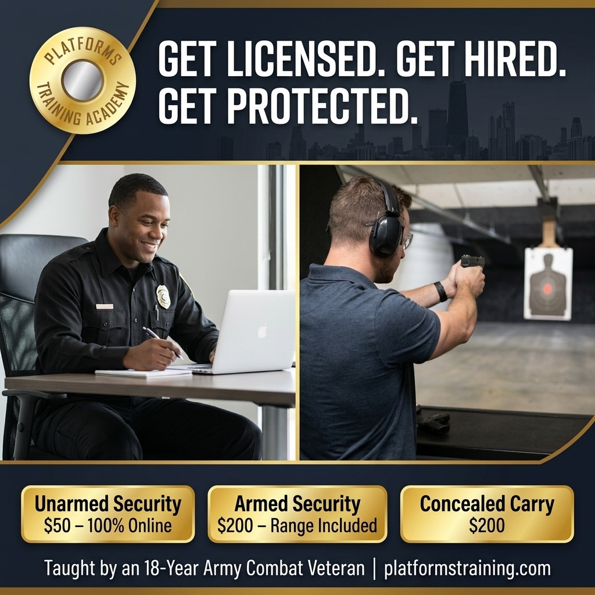
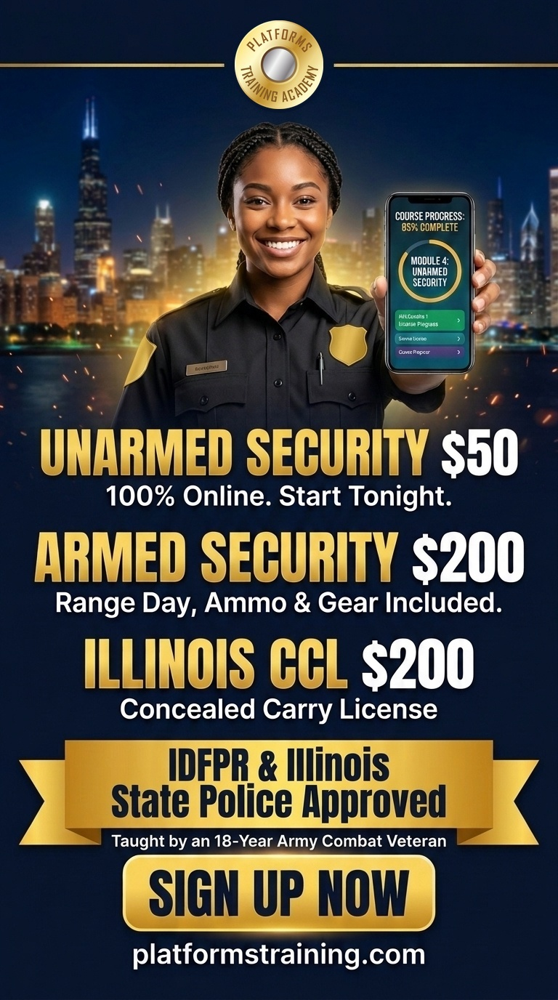
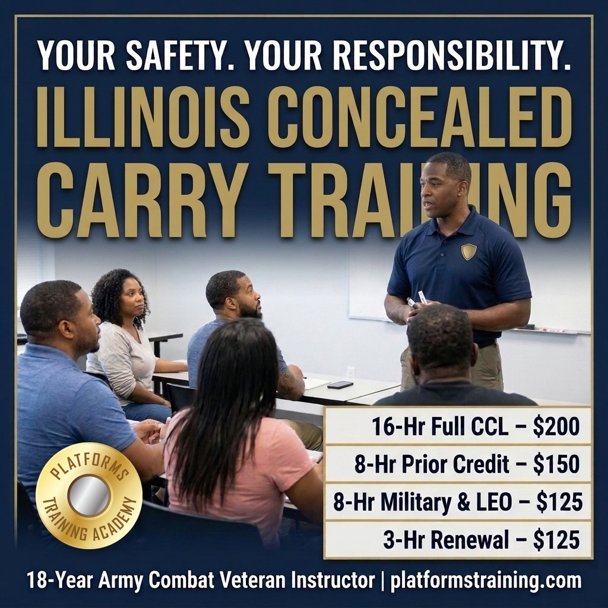

# Facebook Ad – Platforms Training Academy

## Final Creatives

### Version A – Feed (1:1)

### Version B – Reels/Stories (9:16)

### Version C – Concealed Carry (1:1)

---

## Version A – Main Ad (Security + CCL)

**Primary Text:**

> 🚨 Chicago, your next paycheck (and your peace of mind) starts here. 🚨
>
> Want a career in security? Want to carry legally and confidently? Learn from someone who's been there: an **18-year U.S. Army combat veteran** and NRA Certified Law Enforcement Instructor.
>
> 🛡️ **20-Hr Unarmed Security (PERC Card): only \$50.** 100% online, go at your own pace 24/7. Pass the exam and get your IDFPR certificate right away.
> 🎯 **28-Hr Armed Security (Tan Card): \$200.** 20 hours online plus an 8-hour live-fire range day. Ammo, targets, eye/ear protection, and range fees are **all included**.
> 🔫 **16-Hr Illinois Concealed Carry: \$200.** Classroom plus range qualification, approved by the Illinois State Police.
>
> ✅ IDFPR-Approved Curriculum #102-000398
> ✅ Study from your phone, on your schedule
> ✅ Military & LEO discounts on CCL
>
> Security companies are hiring NOW. Get licensed this week, not "someday." 👇
>
> 📞 (773) 873-2591
> 🌐 platformstraining.com

**Headline:** Get Your PERC, Tan Card, or CCL – Starting at \$50
**Description:** IDFPR-Approved • Veteran-Led • Chicago
**CTA Button:** `Sign Up` (or `Learn More`)
**Link:** https://platformstraining.com/courses.html

---

## Version B – Short & Punchy (good for Reels/Stories)

> Unarmed Security license for **\$50**. Online. Tonight. 📱
> Need to go armed? **\$200**, with range day, ammo & gear included. 🎯
> Ready to carry? Illinois **CCL: \$200**. 🔫
> IDFPR & Illinois State Police approved. Taught by an 18-year Army combat vet. 🇺🇸
> 👉 platformstraining.com

**Headline:** Licensed. Hired. Protected.

---

## Version C – Concealed Carry Focus

> Your safety is YOUR responsibility. Are you ready? 🇺🇸
>
> Get your **Illinois Concealed Carry License** training from an 18-year combat veteran who makes learning clear, safe, and confidence-building, even if you've never held a firearm.
>
> 🔹 16-Hr Full CCL: \$200
> 🔹 8-Hr w/ Prior Credit: \$150
> 🔹 8-Hr Military & Law Enforcement: \$125
> 🔹 3-Hr Renewal Refresher: \$125
>
> 📍 Classroom: 200 E 75th St, Chicago | Range: Eagle Sports Range, Oak Forest
> Seats fill fast. Reserve yours 👉 platformstraining.com/calendar.html

**Headline:** Illinois CCL Training – Veteran Instructor
**CTA Button:** `Book Now`

---

## Targeting Suggestions
- **Location:** Chicago + 25–40 mi radius (South Side, south suburbs, NW Indiana border)
- **Age:** 21–55
- **Interests:** Security guard jobs, law enforcement, Second Amendment, NRA, concealed carry, job seeking, veterans
- **Placements:** FB/IG Feed (1:1 image above), Reels/Stories (Version B)

> [!WARNING]
> Meta restricts ads that **promote firearms** and limits weapon imagery. Training and safety courses are usually allowed, but the gun-at-range image may get flagged. If that happens, use a creative without a visible firearm (for example, only the security officer side) and keep the copy focused on "training," "safety," and "licensing."
